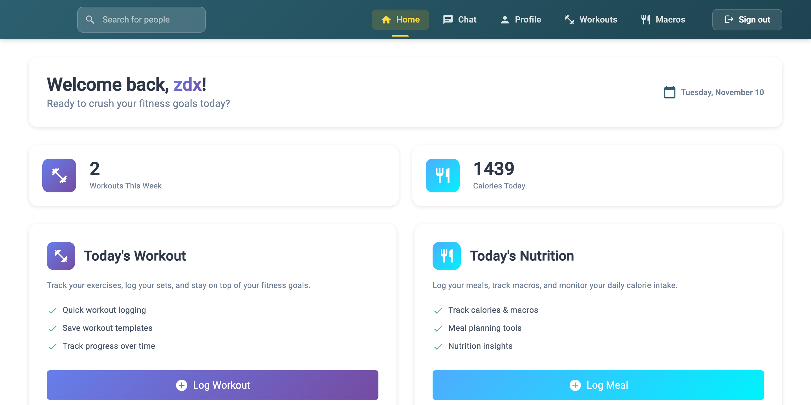
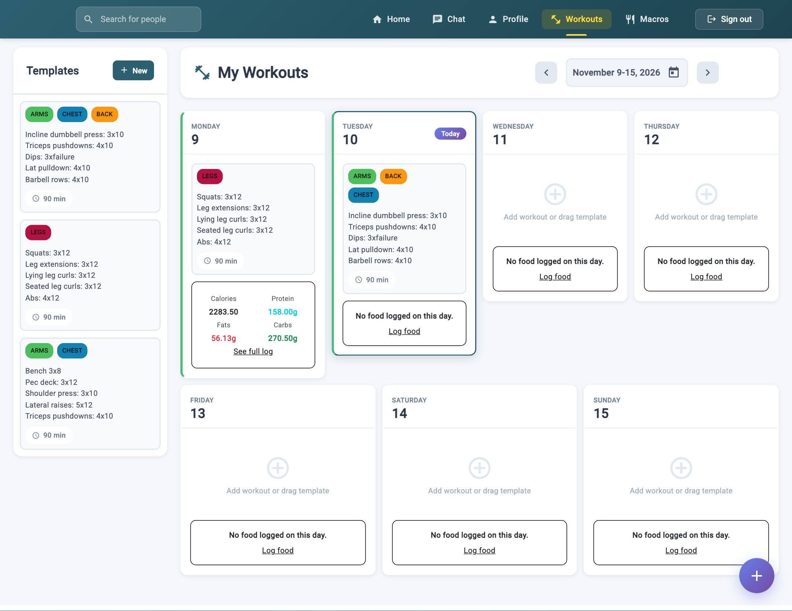
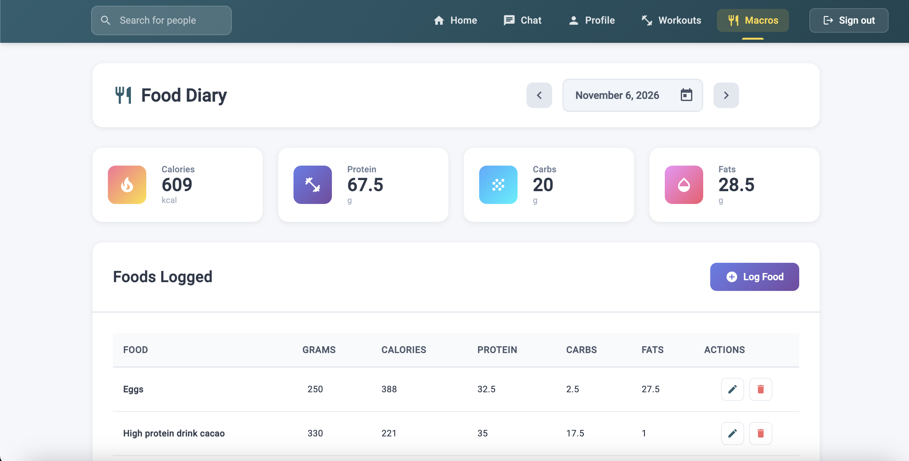
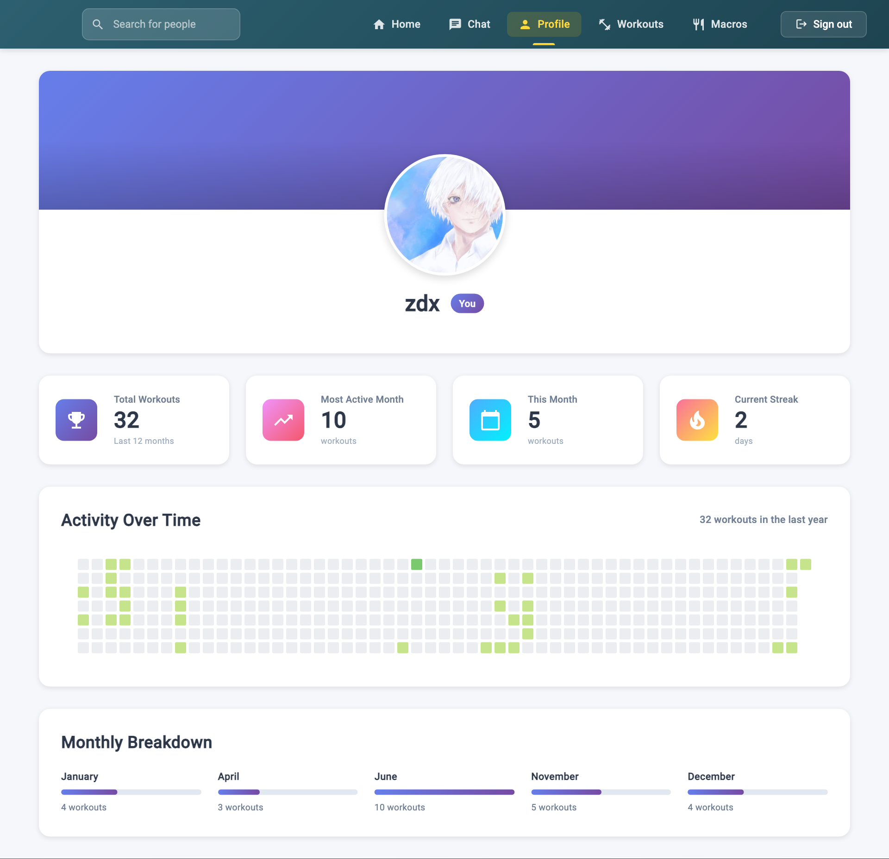
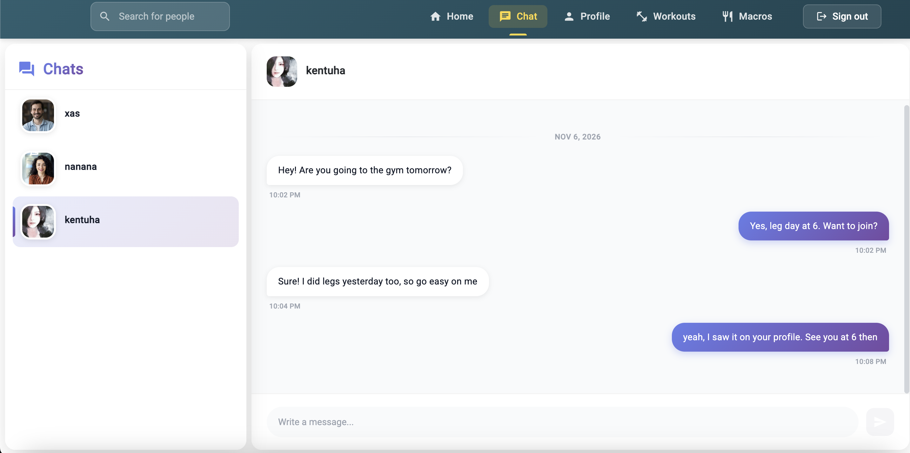

# Spotter

[](https://github.com/MitaAndrei/spotter/actions/workflows/ci.yml)

A full-stack fitness tracker: log workouts and meals, follow your macros, add friends, look at their activity, and chat with them in real time.

## Live demo

**https://gymapp.swedencentral.cloudapp.azure.com**

Log in with username `demo` and password `parolademo123`. The account comes with a year of workouts, two weeks of meals, and a friend, `alex`, to chat with. You can also register your own account.

## Features

- **Workouts:** log workouts with duration and the muscle groups you trained, save reusable workout templates, and see your history on an activity graph.
- **Macro tracker:** keep a shared food catalog and log what you eat each day (calories, protein, fats, carbs).
- **Social:** search for users, send and accept friend requests, and view friends' profiles and workouts.
- **Real-time chat** between friends, built on SignalR.
- **Profile pictures** stored in AWS S3 and served through pre-signed URLs.
- **Auth:** JWT access tokens with refresh tokens.
- **Caching:** Redis caches the food catalog, workout templates and user profiles, and clears the cached entry whenever that data changes.

## Tech stack

| Layer    | Technologies |
|----------|--------------|
| Frontend | Angular 17 (standalone components), Angular Material, Bootstrap 5, RxJS, `@microsoft/signalr` |
| Backend  | ASP.NET Core 10 Web API, Entity Framework Core 10 (Npgsql provider), SignalR, JWT Bearer auth, Swagger |
| Data     | PostgreSQL 17, Redis 7 (`IDistributedCache`), AWS S3 |

## Screenshots

| Home | Workouts | Macro tracker |
|------|----------|---------------|
|  |  |  |

| Profile | Chat |
|---------|------|
|  |  |

## Project structure

```
api/gymappAPI/   ASP.NET Core API (Controllers → Managers → EF Core DbContext)
api/gymappAPI.Tests/   integration tests (xUnit + WebApplicationFactory)
client/          Angular app (core/, layout/, shared/, features/)
docker-compose.yml   the whole app in containers
docker-compose.dev.yml   publishes Postgres and Redis, for running from source
docker-compose.prod.yml, Caddyfile   the server setup, with HTTPS
docs/deploy-vps.md   setting up the server and deployments
```

## Getting started

### Run everything with Docker

The only prerequisite is [Docker](https://www.docker.com/products/docker-desktop/):

```bash
docker compose up --build
```

Open http://localhost:8080 and create an account. The database tables are created on the first start, and the data stays in a Docker volume between runs (`docker compose down -v` deletes it).

This starts Postgres, Redis, the API, and nginx, which serves the client and forwards API and chat traffic to the API. No configuration is needed to try it locally: uploading a profile picture shows an error until you add S3 credentials, and everything else works. To change the port, the database password or the JWT signing key, or to add S3 credentials, copy `.env.example` to `.env`.

The default password and signing key are public, so the app is only published on `127.0.0.1`. Set your own in `.env` before running it anywhere else.

### Run from source

Use this to work on the code, with hot reload on the client.

#### Prerequisites

- [.NET 10 SDK](https://dotnet.microsoft.com/download/dotnet/10.0)
- [Node.js 18+](https://nodejs.org/) and the Angular CLI (`npm i -g @angular/cli@17`)
- PostgreSQL and Redis. The easiest way to get both is the Docker command in step 1.
- An AWS S3 bucket, only if you want profile picture uploads to work

#### 1. Start Postgres and Redis

```bash
docker compose -f docker-compose.yml -f docker-compose.dev.yml up -d postgres redis
```

This publishes them on `localhost:5432` and `localhost:6379`, so stop anything else using those ports first.

#### 2. Configure the API secrets

Secrets are **not** stored in `appsettings.json`. In development the API reads them from [.NET User Secrets](https://learn.microsoft.com/aspnet/core/security/app-secrets):

```bash
cd api/gymappAPI

dotnet user-secrets set "ConnectionStrings:AppDbConnectionString" "Host=localhost;Database=gymapp;Username=gymapp;Password=changeme"
dotnet user-secrets set "ConnectionStrings:Redis" "localhost:6379,abortConnect=false"
dotnet user-secrets set "JwtSettings:Key" "$(openssl rand -base64 64)"

# Optional: profile pictures
dotnet user-secrets set "AWS:BucketName" "<bucket>"
dotnet user-secrets set "AWS:AccessKey"  "<access key>"
dotnet user-secrets set "AWS:SecretKey"  "<secret key>"
```

In production, use environment variables instead. A double underscore stands for a nested key:

```bash
export ConnectionStrings__AppDbConnectionString="Host=...;Database=...;Username=...;Password=..."
export ConnectionStrings__Redis="redis:6379,abortConnect=false"
export JwtSettings__Key="..."
export AWS__BucketName="..." AWS__AccessKey="..." AWS__SecretKey="..."
```

If `ConnectionStrings:Redis` is empty, the API falls back to an in-memory cache, so Redis is optional for local development. If the database connection string or the JWT key is missing, the API stops at startup and prints an error saying which one.

#### 3. Create the database and run the API

```bash
cd api/gymappAPI
dotnet tool install --global dotnet-ef   # first time only
dotnet ef database update
dotnet run --launch-profile https
```

The API listens on `https://localhost:7225`. Swagger UI is at `https://localhost:7225/swagger`.

#### 4. Run the client

```bash
cd client
npm ci
npm start
```

Open http://localhost:4200.

## Deployment

The live demo runs these same containers on one Linux server, with Caddy in front for HTTPS. After a one-time setup, every push to `main` that passes CI is built into images on GitHub Actions and deployed to the server. See [docs/deploy-vps.md](docs/deploy-vps.md).

## Tests

```bash
cd api
dotnet test
```

The integration tests start the real API in memory, with SQLite instead of Postgres and a fake S3, so they need no running services and no secrets. They cover login and refresh tokens, access to other users' workouts, logged foods and images, validation, and the chat hub.

## API

All endpoints under `/api/auth` are public; the rest need a `Bearer` access token. Register and login are limited to 10 requests per minute per client address (`RateLimiting:AuthPermitLimit`). Swagger UI is at `/swagger` in development.

| Method | Route | Description |
|--------|-------|-------------|
| POST | `/api/auth/register`, `/api/auth/login` | Create an account, log in (returns access and refresh tokens) |
| POST | `/api/auth/refresh`, `/api/auth/logout` | Rotate the refresh token, revoke it |
| GET | `/api/users/me` | The logged-in user |
| GET | `/api/users?search=` , `/api/users/{username}` | Search users (up to 20 results), get a profile |
| GET | `/api/users/{id}/workouts`, `/api/users/{id}/logged-foods` | A friend's workouts and food diary (`?from=&to=`) |
| GET | `/api/users/{id}/friends` | Your friends, or a friend's friends |
| GET, POST | `/api/workouts` | Your workouts (`?from=&to=`), create one |
| GET, PUT, DELETE | `/api/workouts/{id}` | One workout |
| GET | `/api/workouts/templates` | Your workout templates |
| GET, POST | `/api/foods` | The shared food catalog |
| GET, POST | `/api/logged-foods` | Your food diary (`?date=` or `?from=&to=`), log foods |
| PATCH, DELETE | `/api/logged-foods/{id}` | Change the grams, remove an entry |
| POST | `/api/friends/requests` | Send a friend request |
| POST, DELETE | `/api/friends/requests/{userId}/accept`, `/api/friends/requests/{userId}` | Accept, decline |
| GET, DELETE | `/api/friends/{userId}/status`, `/api/friends/{userId}` | Friendship status, unfriend |
| GET | `/api/chats/{userId}/messages` | Chat history (`?before=&limit=`) |
| POST, GET, DELETE | `/api/images`, `/api/images/{key}/url`, `/api/images/{key}` | Profile picture upload, URL, delete |

Real-time messages go through the SignalR hub at `/chatHub` (`SendMessage`, `ReceiveMessage`).

## Caching

| Data | Cache key | TTL | Cleared when |
|------|-----------|-----|--------------|
| Food catalog | `gymapp:foods:all` | 1 h | a food is added |
| Workout templates | `gymapp:workouts:templates:{userId}` | 30 min | that user creates, edits or deletes a workout |
| User profile | `gymapp:users:profile:{username}` | 15 min | the user uploads a new profile picture |

If Redis is unavailable, cache errors are logged and requests are served straight from Postgres.
